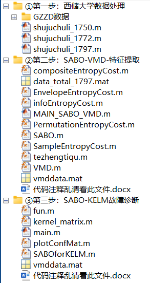
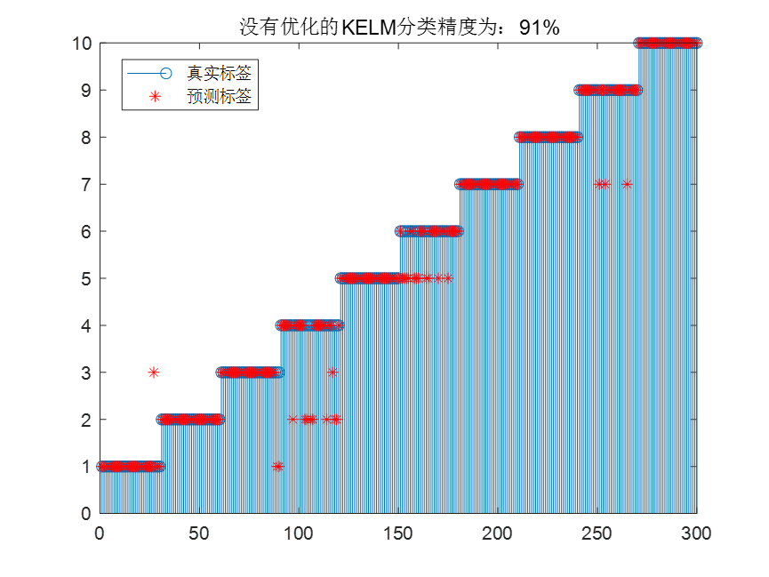
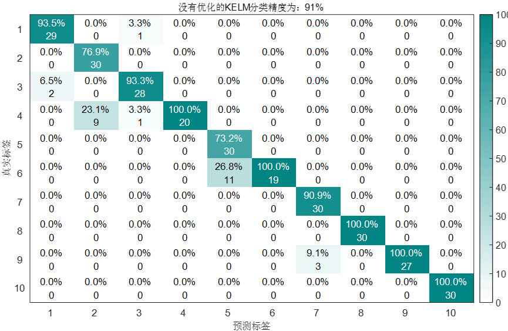
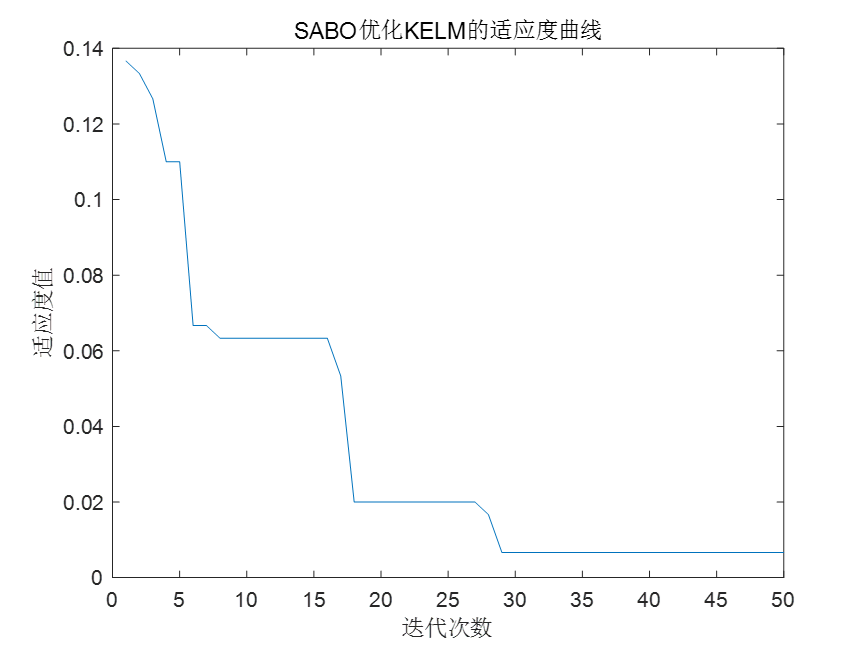
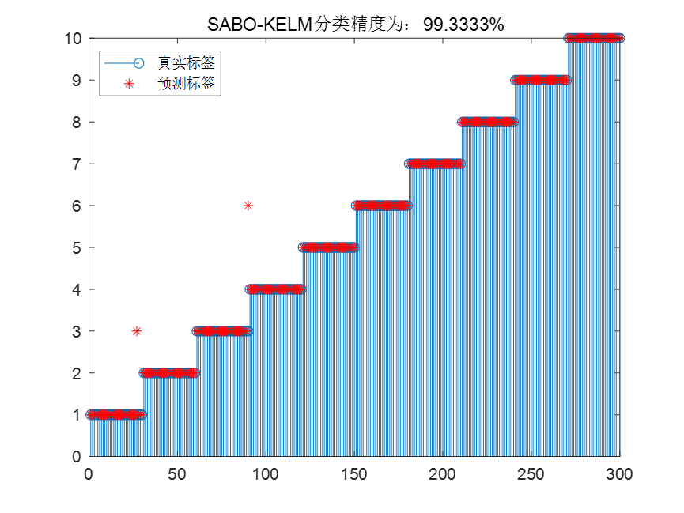
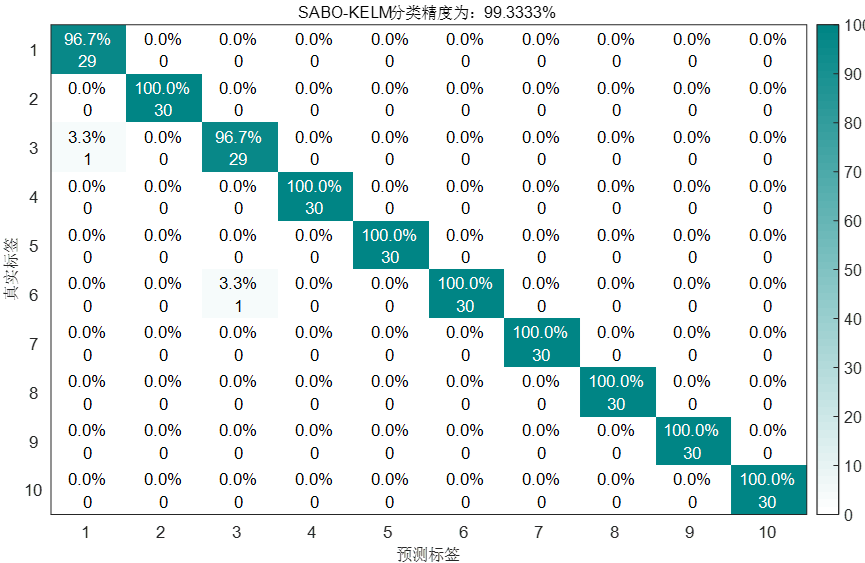

# Superior Tutorial on VMD-SABO-KELM Optimization for Nuclear Limit Learning Machine in Zhongyuan University Bearing Diagnosis

From data processing, optimizing VMD feature extraction to SABO (Subtraction-Average Optimizer) optimization of kernel extreme learning machine for fault diagnosis, a full process of fault diagnosis is realized. Other types of fault diagnosis can refer to this process.
Let's take a look at the folder directory, which has been meticulously organized by the author.
As shown in the figure, this time we have completed three tasks:
1. Process the official download of Western Reserve University data as follows:
1. A total of 10 data sets are loaded, and then select the DE_time (%DE is driver-side data, FE is fan-side data, BA is acceleration data) for each data set.
2. Set the sliding window w, the number of faulty sample points s for each data point, and the sample quantity m for each fault type.
3. After all the data sliding windows are completed, consolidate them into a single data variable.
Regarding the processing of data from Western Reserve University, there was a previous article that discussed it. You can refer to this article: Western Reserve University Bearing Diagnosis Data Processing, Free MATLAB Code Available.
The numbers 1750, 1772, and 1790 in the diagram represent the rotational speeds of bearings at Western Reserve University. When conducting diagnostics, selecting one of these speeds is sufficient; it makes sense to diagnose different faults under the same speed!
II. Extract features from the data obtained in the first step of data processing.
Long-time followers should be aware that there was a previous article about feature extraction at Western Reserve University, but the author was lazy and did not write a large loop. It required everyone to extract features sequentially for each type of data. This time, the author has written a large loop for feature extraction, making it convenient for one-click feature extraction. Everyone can also easily switch their own data!
Regarding the specific principles of feature extraction, they have been thoroughly detailed in this article, which can be accessed for reading. In essence, it involves using the criterion of minimum enclosing entropy to extract the optimal IMF components from each sample, followed by calculating nine indicators for each sample: mean, variance, peak, kurtosis, effective value, peak factor, impulse factor, waveform factor, and margin factor. These nine indicators are then used to construct a feature vector for each sample.
Additionally, this article employs the 2023 more recent and efficient intelligent algorithm - Subtraction Optimizer (SABO) to optimize the VMD parameters. It identifies the optimal IMF components for each fault type and utilizes the criterion of minimum enclosing entropy to extract the best IMF components.
III. The regularization parameters and kernel parameters of the SABO are optimized for the kernel-limited learning machine.
This is not elaborated on further; interested readers can search for articles on intelligent algorithms optimizing kernel-limited learning machines, which will be abundant.
Results Display
Unoptimized KELM classification results:
Confusion matrix graph, some articles may use this type of graph:
SABO-KELM fitness curve graph:
Optimized KELM classification results:
Optimized KELM classification confusion matrix graph:
Partial code

## Images

<!-- PAYMENT_BLOCK -->

## Get this dataset

- Payment link (Stripe): [Buy now](https://buy.stripe.com/3cs8yP7sY87d0vu9AB)
- Payment QR code: 

<!-- /PAYMENT_BLOCK -->
